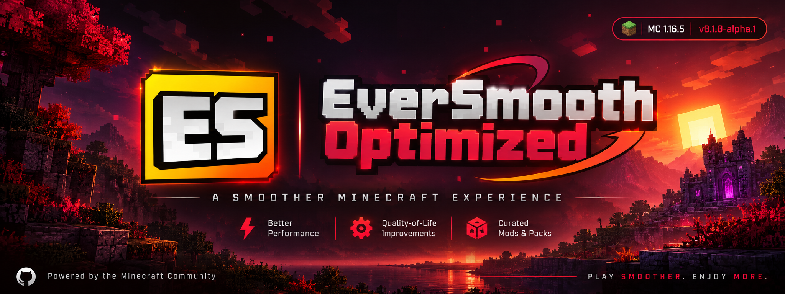

#  EverSmooth Optimized

<p align="center">
  <strong>A smoother Minecraft experience.</strong>
</p>

EverSmooth Optimized is a Minecraft modpack focused on improving game performance and providing useful quality-of-life enhancements while preserving the familiar Minecraft experience.

---

## Overview

| Information | Details |
|---|---|
| Project | EverSmooth Optimized |
| Minecraft Version | 1.16.5 |
| Mod Loader | Fabric |
| Current Release | `0.1.0-alpha.1` |
| Maintainer | [ReysoKree](https://github.com/ReysoKree) |
| Wiki | [EverSmooth Optimized Wiki](https://eversmooth-optimized-wiki.vercel.app) |

## Features

- Performance-focused modifications
- Quality-of-life improvements
- Carefully selected resource packs
- Packwiz-based modpack management
- Python-based project management and automation tools
- Release metadata validation and synchronization
- Automated release reports, changelogs, and backups
- Multiple distribution and installation options

## Included Content

Explore the included content for this release:

- [Mods](content/mods.md)
- [Resource Packs](content/resourcepacks.md)
- [Shaders](content/shaders.md)

## Installation

You can get EverSmooth Optimized through any of the following methods:

1. **Modrinth:** Download the modpack from its Modrinth project page.
2. **CurseForge:** Download the modpack from its CurseForge project page.
3. **GitHub Releases:** Download a published release archive directly from the GitHub repository.
4. **Build Your Own:** Clone the repository and create a fresh modpack export using the included Packwiz source files and project tools.

After obtaining the modpack:

1. Import it into a compatible Minecraft launcher.
2. Ensure the required Minecraft version and Fabric Loader are installed.
3. Launch Minecraft and enjoy EverSmooth Optimized.

For manual installation, you can also use the Handloom export, which provides the mod and resource pack files in their respective folders.

## Project Tools

EverSmooth Optimized includes a collection of Python scripts for managing the project, validating metadata, exporting modpacks, comparing releases, generating reports, and more.

To access the interactive menu containing all available tools, run this command from the project root:

```powershell
python scripts/menu.py
```

The menu provides access to the available project, release, maintenance, and information tools.

## Project Structure

```text
eversmooth-optimized/
│
├── assets/             # Project branding and visual assets
├── backups/            # Complete project backup archives
├── content/            # Included mods, resource packs, and shaders
├── metadata-exports/   # Exported metadata documents
├── packwiz/            # Packwiz source files for each Minecraft version
├── platforms/          # Platform-specific modpack distributions
├── releases/           # Generated modpack release archives
├── reports/            # Generated release reports
├── scripts/            # Python project management and automation tools
├── versions/           # Release-specific metadata and documentation
│
├── .github/            # GitHub templates and workflows
├── .vscode/            # Visual Studio Code settings
│
├── CHANGELOG.md
├── CODE_OF_CONDUCT.md
├── CONTRIBUTING.md
├── LICENSE
├── README.md
└── modpack-info.json
```

## Contributing

Contributions, suggestions, and bug reports are welcome.

Please read [CONTRIBUTING.md](CONTRIBUTING.md) before submitting changes.

## License

This project is distributed under its custom license.

See [LICENSE](LICENSE) for details. Third-party modifications and resources remain subject to their respective licenses.

---

<p align="center">
  Made with care for the Minecraft community.
</p>
